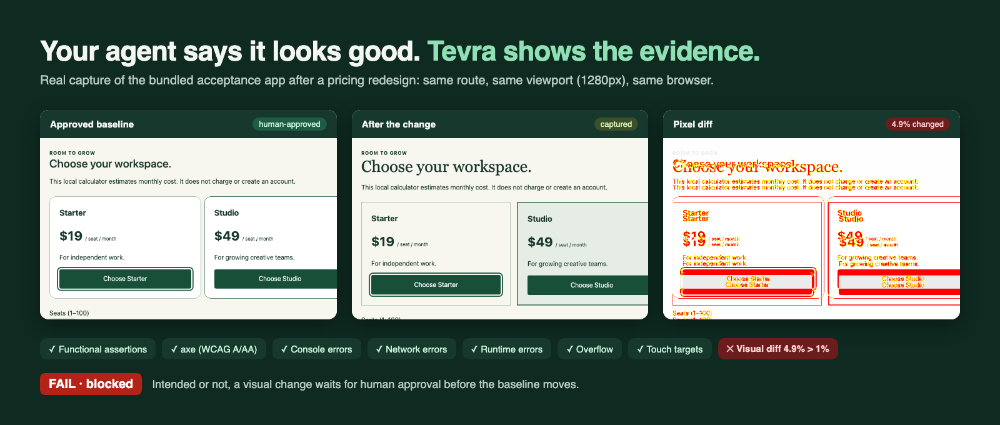
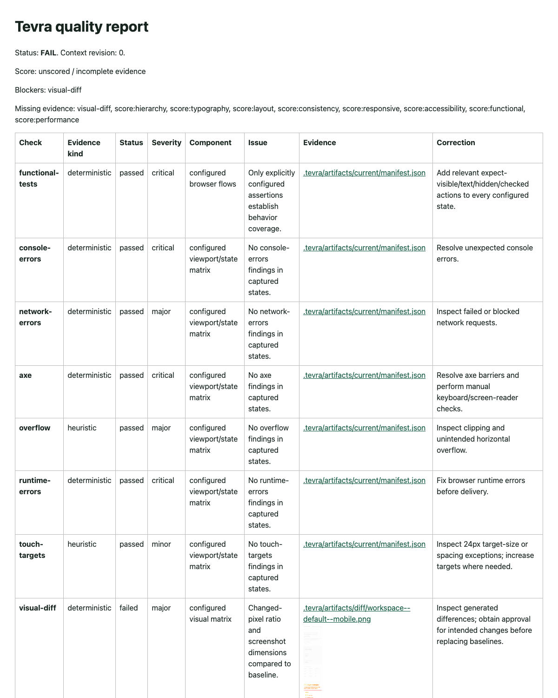

# Tevra Design Kit

**Design and frontend QA skills for coding agents, with a CLI that proves the work.**

Tevra gives your coding agent twelve focused skills for researching, building, redesigning and reviewing user interfaces, and a local CLI that turns "looks good to me" into evidence: real screenshots, pixel diffs, accessibility results, performance metrics and a quality report that blocks delivery when something critical fails.

Works with **Claude Code, Codex, Cursor, Kiro, Gemini CLI, GitHub Copilot, OpenCode and Windsurf**.

[](https://github.com/tevra-si/design-kit/actions/workflows/ci.yml)   



---

- [Why Tevra](#why-tevra)
- [See it in action](#see-it-in-action)
- [The skills](#the-skills)
- [Requirements](#requirements)
- [Installation](#installation)
- [Configure a project](#configure-a-project)
- [Quick tour](#quick-tour)
- [Update and uninstall](#update-and-uninstall)
- [Troubleshooting](#troubleshooting)
- [Documentation](#documentation)

## Why Tevra

- **Respects your design system.** Every skill inspects and reuses the project's tokens and components first. Tevra never introduces a parallel system.
- **Evidence over opinion.** Checks produce files you can open: screenshots, diffs, axe output, Lighthouse JSON. A missing tool is reported as an error, never as a pass.
- **Humans stay in charge.** Baselines, transformative redesigns and brand changes need an explicit, recorded approval.
- **Local and private.** Everything lives in the project's `.tevra/` folder. Nothing is uploaded, committed or sent to a model by the CLI.
- **Agent-agnostic.** Plain Markdown skills in the open Agent Skills format, installable into eight agents.

## See it in action

The image above is a real run on the bundled [acceptance app](examples/acceptance-app/README.md): a pricing redesign captured across 3 states × 4 viewports. Every behavior, axe, console, network, overflow and touch-target check passed, yet delivery is blocked because 3–7% of pixels changed and nobody has approved the new look. Reproduce it yourself:

```sh
pnpm --filter @tevra/acceptance-app build:before && pnpm --filter @tevra/acceptance-app start   # terminal 1
tevra-design init --root examples/acceptance-app --yes --skip-skills                            # terminal 2
tevra-design capture --root examples/acceptance-app --kind baseline --approve-baseline
pnpm --filter @tevra/acceptance-app build                                                       # apply the redesign
tevra-design capture --root examples/acceptance-app
tevra-design compare --root examples/acceptance-app
tevra-design report  --root examples/acceptance-app                                             # FAIL: visual-diff
```

Every finding links to its evidence in the HTML report:



## The skills

| Skill | Use it when |
| --- | --- |
| `design-research` | The brief, users or problem are unclear and need evidence first |
| `design-direction` | Starting substantial new UI or a redesign, or turning a screenshot into a direction |
| `design-system` | Creating or extending tokens, themes, dark mode or component variants |
| `ui-builder` | Building or changing a real screen, component, route or form |
| `ui-redesign` | Improving an existing screen without breaking its behavior |
| `responsive-design` | Fixing mobile/tablet layouts, overflow, breakpoints or safe areas |
| `interaction-motion` | Adding feedback, transitions, loading states or reduced-motion behavior |
| `visual-review` | Comparing screenshots, approving baselines or scoring visual quality |
| `accessibility-qa` | Checking WCAG, keyboard and focus, labels and contrast |
| `browser-testing` | Writing or running end-to-end tests of real user flows |
| `performance-qa` | A page feels slow, or you need Lighthouse, LCP, CLS or TBT |
| `frontend-review` | Reviewing frontend code or a diff before merge |

Agents pick skills automatically from your request. Bigger requests chain several skills. For example, "build a new dashboard" runs research → direction → system → builder → responsive → visual review → accessibility.

## Requirements

| Needed for | Requirement |
| --- | --- |
| CLI | Node `^22.22.2`, `^24.15.0` or `>=26`, and pnpm 11 |
| Screenshots, axe, Lighthouse | A Chromium-based browser Playwright can launch |
| Claude Code plugin | Claude Code with plugin support (`claude plugin --help` lists the commands) |

## Installation

Choose **A** for skills in Claude Code, **B** for the CLI and any other agent. Most teams use both.

### A. Claude Code plugin

```sh
claude plugin marketplace add tevra-si/design-kit
claude plugin install tevra@tevra
```

Or inside a session: `/plugin marketplace add tevra-si/design-kit`, then `/plugin install tevra@tevra`.

Open a **new** session (skills load at startup) and type `/tevra` to see them. Skills are namespaced as `tevra:<skill>`, such as `/tevra:ui-builder`, so they never collide with a project skill of the same name.

### B. CLI and skills for any agent

**1. Install the CLI**

From npm:

```sh
npx tevra-design-kit help                    # run without installing
npm install --global tevra-design-kit        # or install the `tevra-design` command
npx playwright install chromium              # browser for screenshots and axe
```

Or from source:

```sh
git clone https://github.com/tevra-si/design-kit.git
cd design-kit
pnpm install
pnpm build
npm link                                # adds `tevra-design` to your PATH
pnpm exec playwright install chromium   # browser for screenshots and axe
tevra-design help
```

After `git pull`, run `pnpm build` again; the linked command uses your clone.

**2. Add Tevra to a project**

```sh
cd /path/to/your-project
tevra-design init --yes --agents claude,cursor
```

| `--agents` | Installs into |
| --- | --- |
| `claude` | `.claude/skills/` |
| `codex` | `.agents/skills/` |
| `cursor` | `.cursor/skills/` |
| `kiro` | `.kiro/skills/` |
| `gemini` | `.gemini/skills/` |
| `copilot` | `.github/skills/` |
| `opencode` | `.opencode/skills/` |
| `windsurf` | `.windsurf/skills/` |

Use one folder per agent: Gemini CLI also reads `.agents/skills`, and Copilot also reads `.claude/skills` and `.agents/skills`. Installing twice shows every skill twice. See [supported agents](docs/agents.md) for details.

`init` also creates `.tevra/` with the project config, design context and memory. Add `.tevra/` to your `.gitignore`.

Useful variations:

```sh
tevra-design init                                       # interactive
tevra-design skills install --agents codex --dry-run    # preview only
tevra-design init --yes --skip-skills                   # config and context only
```

The installer never overwrites a file you changed; on any conflict it stops without writing anything.

**3. Restart your agent** in the project so it loads the skills.

## Configure a project

Start your app, then tell Tevra where it runs and which screens matter in `.tevra/config.json`:

```json
{
  "baseURL": "http://localhost:3000",
  "permittedOrigins": ["http://localhost:3000"],
  "routes": [
    {
      "name": "checkout",
      "path": "/checkout",
      "states": [
        { "name": "default", "actions": [], "masks": [] },
        {
          "name": "invalid-email",
          "actions": [
            { "type": "fill", "selector": "#email", "value": "not-an-email" },
            { "type": "click", "selector": "button[type=submit]" },
            { "type": "expect-visible", "selector": "#email-error" }
          ],
          "masks": ["[data-testid=order-number]"]
        }
      ]
    }
  ]
}
```

Keep the other fields `init` generated (viewports, thresholds, weights). Only `permittedOrigins` may be loaded. `masks` hide private or changing content in screenshots. Never put real credentials or customer data in actions. Full reference: [configuration](docs/configuration.md).

> **Pages behind a login.** The CLI's browser starts signed out. Check those pages by asking your agent to use an already signed-in browser, and keep the CLI for public pages, test environments and CI.

## Quick tour

**Ask your agent:**

```
The pricing table overflows on mobile, fix it
/tevra:accessibility-qa check the signup form
Review this diff before I merge
```

**Plan and research:**

```sh
tevra-design workflow plan "Improve pricing card" --mode quick
tevra-design search "form error validation" --limit 5
tevra-design analyze
```

**Verify a running app:**

```sh
tevra-design doctor --launch                              # browser starts
tevra-design capture --kind baseline --approve-baseline   # after a human approves the screens
tevra-design capture && tevra-design compare              # what changed?
tevra-design a11y                                         # axe on every route, state and viewport
tevra-design test performance --allow-network             # Lighthouse lab metrics
tevra-design report                                       # .tevra/reports/quality.{md,json,html}
```

Exit codes: `0` passed, `1` a check failed, `2` input or environment error. See [usage](docs/usage.md) for workflows, evidence, context and memory.

## Update and uninstall

| | Update | Uninstall |
| --- | --- | --- |
| Plugin | `claude plugin marketplace update tevra` then `claude plugin update tevra@tevra` | `claude plugin uninstall tevra@tevra` and `claude plugin marketplace remove tevra` |
| CLI from npm | `npm install --global tevra-design-kit@latest` | `npm uninstall --global tevra-design-kit` |
| CLI from source | `git pull && pnpm install && pnpm build` in your clone | `npm unlink -g tevra-design-kit` |
| Project skills | Move the old Tevra skill folders aside, then `tevra-design skills install --agents <agent>` | Delete the Tevra skill folders and, if unwanted, `.tevra/` |

## Troubleshooting

| Symptom | Fix |
| --- | --- |
| A skill like `/ui-builder` does not appear | The skills are in another agent's folder, or the session started before the install. Use the plugin, or `--agents claude`, then open a new session |
| `Installation conflict; preserve local file` | A skill with the same name already exists (for example `design-system`). Use the plugin, or move the existing folder aside |
| `Marketplace file not found` | Pull the latest `main`; the repository root must contain `.claude-plugin/marketplace.json` |
| `Unknown agent` | Use one of `codex, claude, cursor, kiro, gemini, copilot, opencode, windsurf` |
| `doctor` fails or the browser cannot launch | Run `pnpm exec playwright install chromium` in the design-kit clone. Some sandboxes block browsers or local servers; Tevra reports the error instead of faking results |
| Screenshots show the sign-in page | The route needs a login; see [Configure a project](#configure-a-project) |
| Capture refuses a URL | Add its origin to `permittedOrigins` |
| `Mask matches no elements` | Every mask selector must exist on the page; fix or remove it |
| `Write lock unavailable` | Another Tevra command is running, or one crashed. Remove the stale `.tevra/*.lock` file |
| Plugin install mentions packages not installed | Expected: the plugin ships skills only; the CLI comes from step B |

## Known limitations

- Automated checks are evidence, not certification. axe and heuristics cannot confirm screen-reader behavior or full WCAG conformance; skills list the manual checks still required.
- Lighthouse results are lab metrics and do not represent real-user data such as INP.
- Browser checks cover web pages. Native React Native/Expo apps need device testing.
- The research catalog is small and local; it cannot report current trends.

## Documentation

| Guide | Contents |
| --- | --- |
| [Usage](docs/usage.md) | Skills, workflows, capture, reports, context, memory, examples |
| [Configuration](docs/configuration.md) | Every config field, actions, privacy, design controls, extensions |
| [Supported agents](docs/agents.md) | Per-agent install paths and activation |
| [Architecture](docs/architecture.md) | Packages, capability ownership, workflow and evidence model |
| [Security](docs/security.md) | Boundaries, protections and limits |
| [Contributing](docs/contributing.md) | Development setup, checks and release steps |
| [Changelog](CHANGELOG.md) | Release history |

## License

MIT. See [LICENSE](LICENSE), [PROVENANCE](PROVENANCE.md) and [third-party notices](THIRD_PARTY_NOTICES.md).
